<a name="topo"></a>
# Terminal Linux para iniciantes

### O que é um terminal de comando?

É uma janela de comunicação direta com o sistema operacional do seu computador. 

**Diferenças entre Terminal, Shell e Console:**
- **Terminal:** É a janela (interface gráfica) onde você digita os seus comandos.

- **Shell:** É o programa interno que lê o que você digita e traduz para linguagem de máquina/sistema (ex: Bash, Zsh).

- **Console:** Antigamente era o hardware físico (conjunto de monitor e teclado ligado diretamente ao servidor); hoje é usado praticamente como sinônimo de terminal.

### Para que serve o terminal?

É uma ferramenta de controle do sistema que permite **gerenciar** arquivos, **instalar/executar** programas, **automatizar** tarefas e **administrar** a máquina (localmente ou remotamente) com maior velocidade e precisão.

### Como abrir o terminal?
Aqui estamos usando o sistema operacional Linux como exemplo, alguns comandos diferem de Linux para Windows. 

    Ctrl + Alt + T


| Exemplo terminal |
| :---: |
| 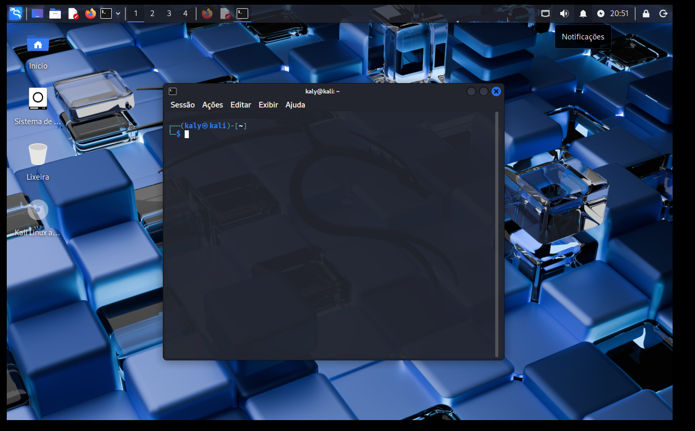|


> ⚠️  **O terminal é *Case Sensitive*!**  
> Letras maiúsculas e minúsculas fazem diferença. O comando `LS` resultará em erro, e uma pasta chamada `Documentos` é diferente de `documentos`.

# Primeiros comandos

### Se localizar:

É muito importante saber em qual pasta/diretório você se encontra e para isso usando o 'print working directory' ou somente **pwd**.<br>
Digitando esse comando no terminal, ele mostrará em qual diretório estamos. 

| Exemplo comando **pwd**|
| :---: |
| 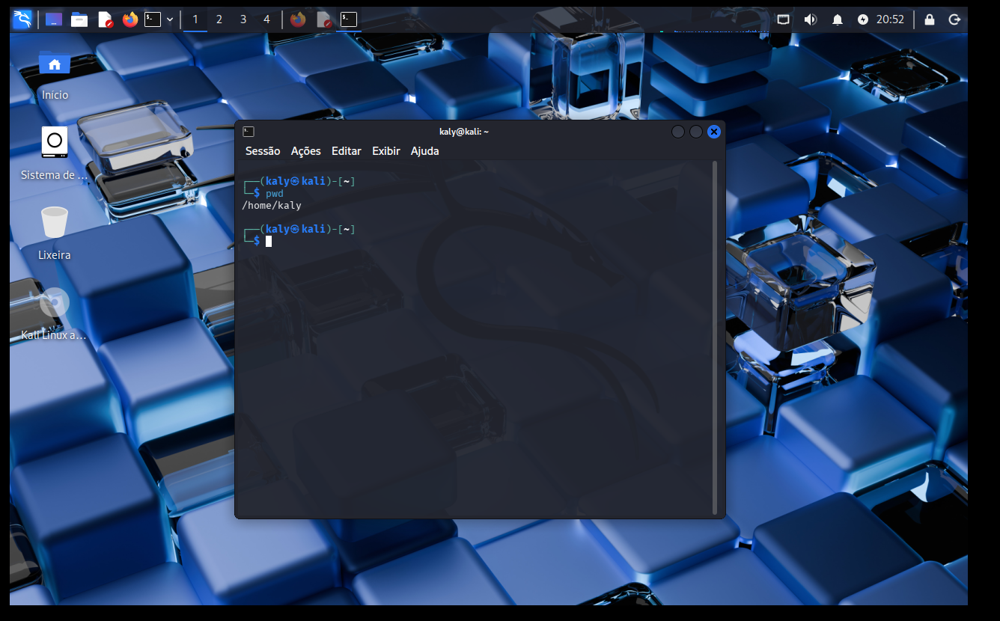|

> 🔍 Um **diretório** é um arquivo especial que armazena uma lista de 
outros arquivos e subdiretórios, mantendo tudo organizado.

o comando **ls** (*note é minúsculo*) é abreviação de **List**(*lista*), e ele literalmente lista os arquivos de um diretório/pasta.

| Exemplo comando **ls**|
| :---: |
| |


O comando **cd** (Change Directory) serve para navegar/entrar nas pastas. Quando você adiciona a barra ao comando `cd /` você diz para o terminal ir pra a raiz do sistema **root directory**.

| Exemplo comando **cd /**|
| :---: |
| 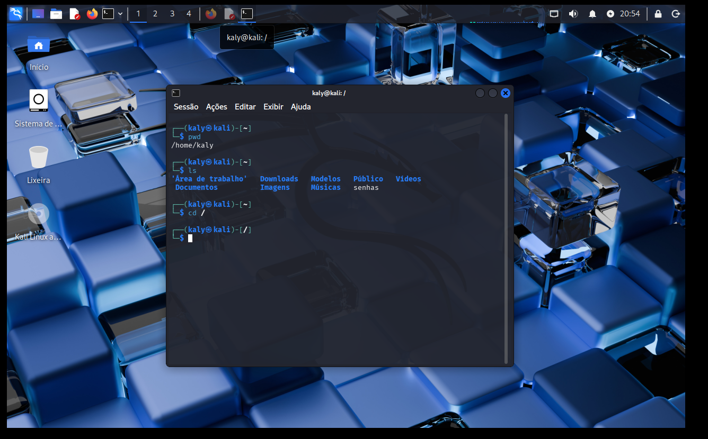|

> Note que no terminal o simbolo **~** (é usado para a pasta pessoal) foi alterado para  **/** (que é usado para a raiz do sistema) o que comprova que mudou de "pasta"

Podemos ainda usar o comando **cd** com algumas combinações como:
- `cd ..` → volta para o diretório anterior.
- `cd /` → vai para o diretório raiz/root .
- `cd /nome_da_pasta` → vai para a nome_da_pasta.
- `cd /caminho/da/pasta` → Vai direto para uma pasta específica a partir da raiz (caminho absoluto).

# Over The Wire

### Bandit Level 0
→ Comando para esse nivel **ssh**.

- O que é o **ssh**?
O comando `ssh`(**Secure Shell**) serve para conectar e controloar computadores ou servidores de forma **remota** e **segura** (criptografada).
- **A porta do SSH:**  
Por padrão, o `ssh` tenta se conectar na **porta 22**, mas ela pode ser alterada pelos administradores de rede.

> ⚠️ Uma porta de rede é o ponto de acesso aos serviços de um sistema operacional.

Geralmente, quando a porta do servidor não é a padrão, usamos a opção `-p` seguida do número da porta desejada.

Ex:
``` bash
ssh -p 2222 bandit0@bandit.labs.overthewire.org
```
# Fase: 0 ➔ 1:

Usando o comando ssh e a senha fornecida pra essa fase, chegamos no terminal padrão, para ver o que tinha eu usei o comando `ls` e ele listou um arquivo *readme*, para abrir esse arquivo eu usei o comando `cat`. Logo em seguida consegui visualizar a senha e pude ir pra próxima fase.

Alguns comandos sugeridos para essa fase:
- `ls` → lista os arquivos do diretório.
- `cd` → muda de diretório (entra em pastas).
- `cat` → exibe o conteúdo do arquivo.
- `file` → mostra o tipo do arquivo.
- `du` → mede o espaço em disco usado pelo arquivo. usando: `du -sh *`
- `find` → procura arquivos e pastas em todo o sistema.


<details>
<summary><b>Senha do nível:
</b></summary>

```bash
6y2kwnwK6grgvwvpvLaa2T1cpFEK0hNR
```
</details>


<br>


| Exemplo comando `ssh` | Exemplo comandos `ls`e `cat`|
| :---: | :---: |
| 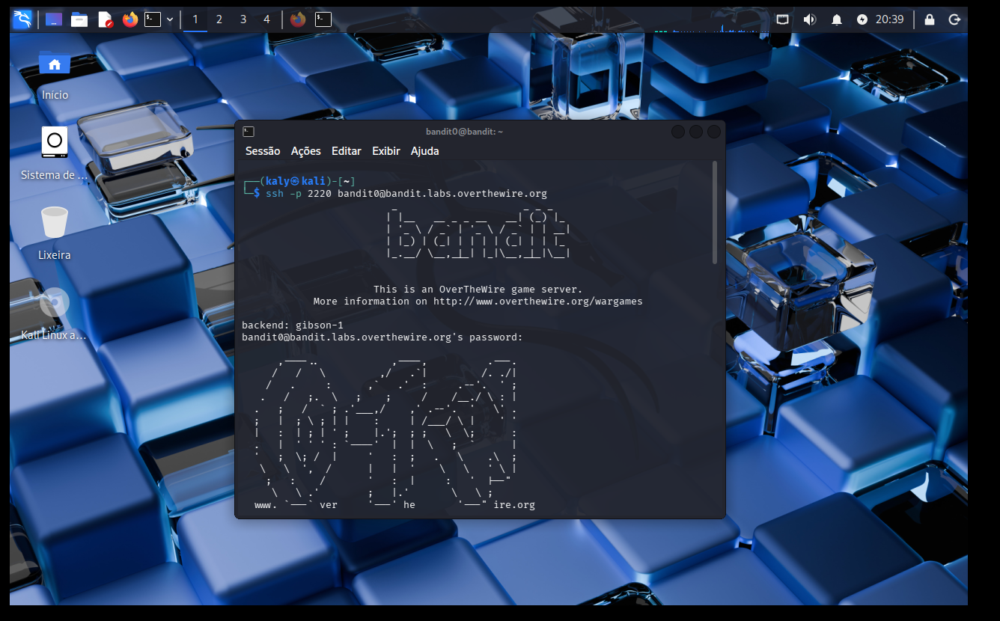 | 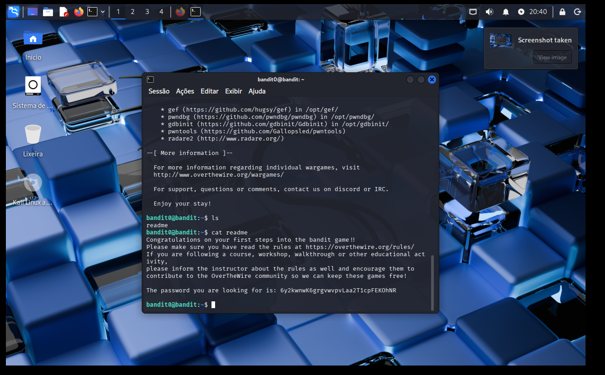 |


# Fase: 1 ➔ 2:


A senha desse nível estava em um arquivo com o nome `-`, se eu usasse apenas o `cat -` ele iria esperar mais algum comando pois ele não reconhece o hífen como um nome de arquivo, para resolver isso, eu forcei o uso do caminho relativo, indicando exatamente onde o arquivo estava no diretorio atual com o comando `cat ./` e em seguida o nome do arquivo, forçando o linux a abrir o comando com o hífem como nome.


<details>
<summary><b>Senha do nível:
</b></summary>

```bash
PK8fYLZg2hnHSz83plBL1iEPKdD3QToB
```
</details>

| Exemplo `cat ./` | 
| :---: | 
| 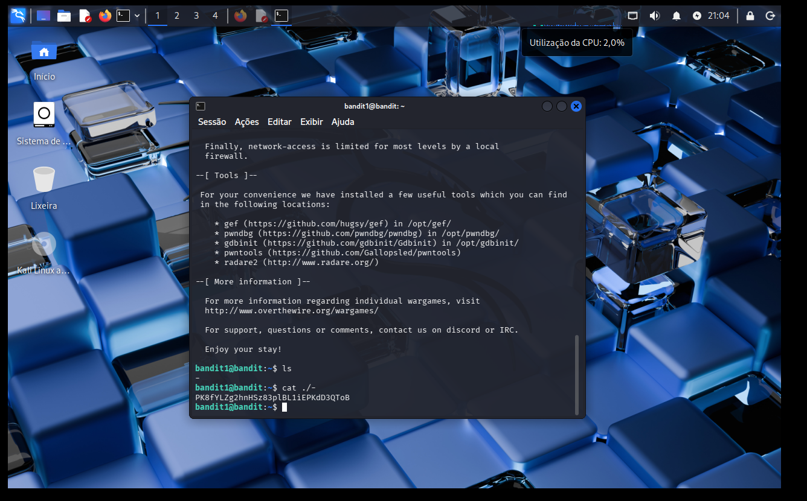 | 


# Fase: 2 ➔ 3:


Nessa fase, o nome do arquivo continha hífens (--), o que fazia o terminal achar que eu estava usando um separador de opções (end-of-options delimiter).

Esse separador serve para dizer ao programa: "a partir daqui, pare de interpretar qualquer coisa que comece com - como uma flag ou parâmetro; trate tudo o que vier a seguir estritamente como argumento literal".

Como o nome do arquivo batia com essa regra, eu precisei forçar o Linux a reconhecê-lo corretamente. Para isso, usei o cat junto com o caminho relativo e coloquei o nome do arquivo entre aspas duplas.

Detalhe da prática: Na minha primeira tentativa, deixei um espaço entre a barra e as aspas (ex: `./ "--arquivo"`), o que gerou erro. Logo depois, corrigi apagando esse espaço (`./"--arquivo"`), garantindo o acesso correto ao conteúdo do arquivo.

<details>
<summary><b>Senha do nível:
</b></summary>

```bash
7ZZ2LFrykP2zEyvBl4m3clcL7tGYJPME
```
</details>

| Exemplo `cat ./"nome do arquivo"` | 
| :---: | 
| 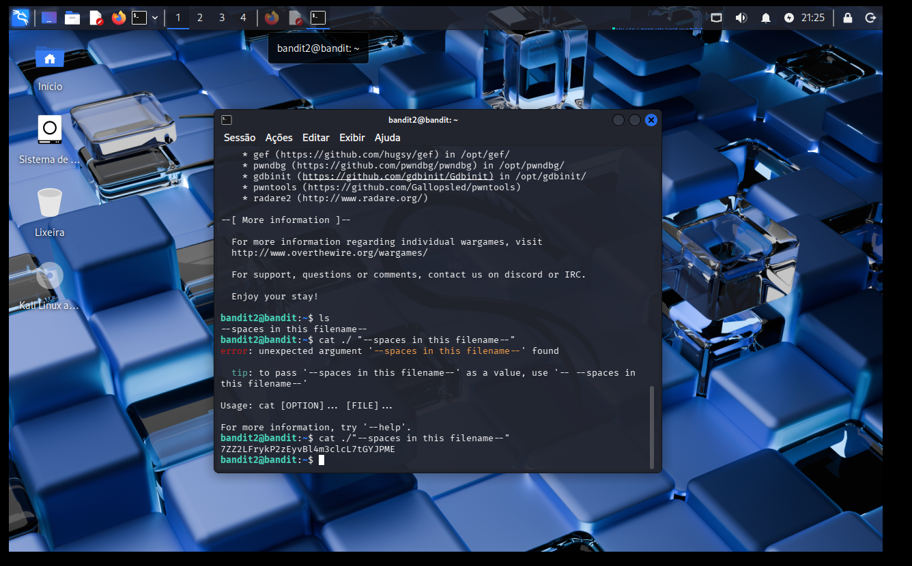 | 

# Fase: 3 ➔ 4:

Nessa fase o desafio foi mais interessante. Ao acessar o nível e usar o comando `ls`, me deparei com um diretório chamado `inhere`. Eu entrei nele com o comando: `cd ~/inhere`.

Logo em seguida, usei o comando `ls` sozinho, mas ele não me retornou nada visível. Isso aconteceu porque os arquivos ali dentro eram **ocultos**. Então, usei a flag `-a` (all) para forçar o Linux a me mostrar tudo: `ls -a`.

Assim, tive acesso aos arquivos ocultos dentro do diretório e pude usar o cat para ler a senha!

> ⚠️ As flags (também conhecidas como opções ou parâmetros) são letras ou palavras que você adiciona a um comando para modificar o comportamento dele.

<details>
<summary><b>Senha do nível:
</b></summary>

```bash
xzTXq1rDJQVVAzdv5cHq1TQytTWufAMq
```
</details>

| Exemplo `ls -a` | 
| :---: | 
| 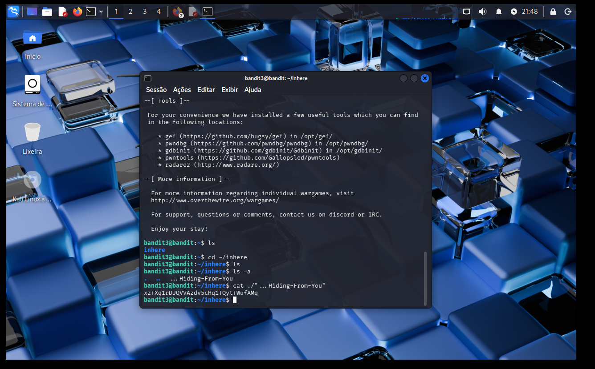 | 

# Fase: 4 ➔ 5:

Essa fase seguiu quase a mesma lógica da última fase, a unica diferença é que existiam vários arquivos, eu poderia rodar o comando `file ./*` para descobrir qual deles era um arquivo de texto legível e ignorar os outros arquivos, mas como sou curiosa, resolvi abrir um por um usando.

<details>
<summary><b>Senha do nível:
</b></summary>

```bash
6C7h9GD8M6ai5nr7wo1RonrzFjj9yIrG
```
</details>

| Exemplo `ls` e `cat ./` | 
| :---: | 
| 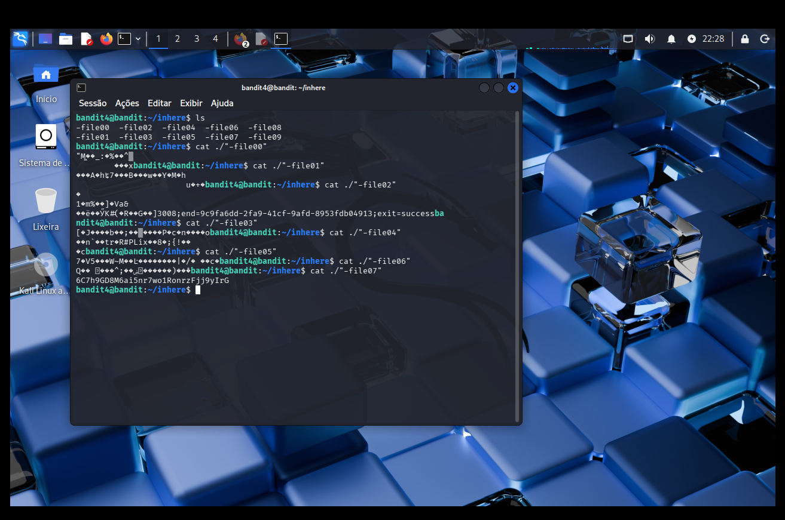 | 

# Fase: 5 ➔ 6:

Essa foi complicada, precisei fazer umas pesquisas para poder achar a senha. Primeiramente vale destacar que nessa fase os arquivos que possuem senhas no **Over The Wire** possuem o tamanho de `1033c` (ele mesmo nos deu esse dado). Com essa informação eu sabia que o único comando possível seria o `find`.

Então o processo já sabemos, entramos no diretório, e eu já soltei o meu cão de caça:
`find . -type f -size 1033c ! -executable`
Ele me retornou o diretório **maybehere07** para acessar ele usei o comando: `cd maybehere07` e soltei mais uma fez meu cão de caça, ai ele me retornou o arquivo `.file2` Ai já não teve mais mistério e consegui a senha. Agora vamos analisar o meu dog:

- `find` → procura arquivos e pastas.
- `.` → diretório atual.
- `-type f` → Só procura arquivos (f de file).
- `size 1033c` → especifiquei o tamanho a ser buscado.
- `! executable` → eu disse que NÃo (!) queria arquivos executáveis.

Então praticamente eu disse: cachorro vá e pega `find`um graveto `type f` médio `size 1033c` e que esteja no chão `! executable`. Estou me divertindo muito haha

<details>
<summary><b>Senha do nível:
</b></summary>

```bash
pXa26xhMWaC2SvDotA4r9EgZkul0eSBW
```
</details>

| Exemplo `find . -type f -size 1033c ! -executable` | 
| :---: | 
| 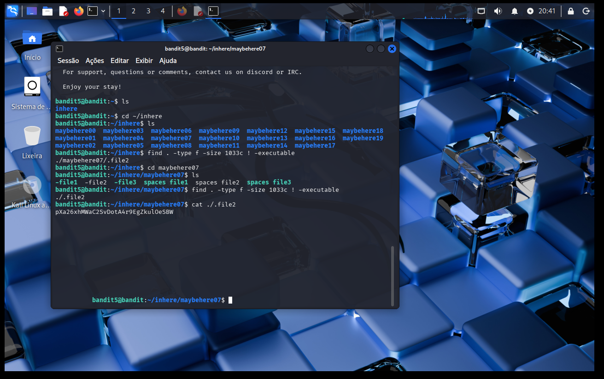 | 


# Fase: 6 ➔ 7:

Que fase foi essa, eu precisei pesquisar  e estudar um pouco pra conseguir fazer ela. O legal foi que o nível já nos deu dicas como o user **bandit7**, grupo **bandit6** e o tamanho do arquivo **33 bytes**. Com esses dados foi bem mais fácil, precisei dar uma pesquisada em como treinar meu "cão" para farejar explosivos. 

Nesse caso eu usei o comando `find / -user bandit7 -group bandit6 -size 33c 2>/dev/null` praticamente foi o mesmo comando da fase passada mas com uns "upgrades", nesse caso eu especifiquei ao meu cachorro que eu queria que ele localizasse explosivos `find /` com componentes elétricos `-user bandit7` e `-group bandit6` que estivessem com líquido inflamável `-size 33c` e que ele não latisse para alarmes falsos `2>/dev/null`. Agora vamos analisar o meu dog:

- `find /` → procura arquivos e pastas em todo o servidor.
- `-user bandit7` → procura arquivos apenas nesse usuário. (Dica jogo)
- `-group bandit6` → procura nesse grupo específico.(Dica do jogo)
- `-size 33c` → especifiquei o tamanho a ser buscado. (Dica do jogo)
- `2>/dev/null` → cereja do bolo, só me retorna resultados válidos (terminal limpo).

<details>
<summary><b>Senha do nível:
</b></summary>

```bash
Bmnnvf82KzQlfxgAI2d1zYbr1u9pr3E3
```
</details>

| Exemplo `find / -user bandit7 -group bandit6 -size 33c 2>/dev/null` | 
| :---: | 
| 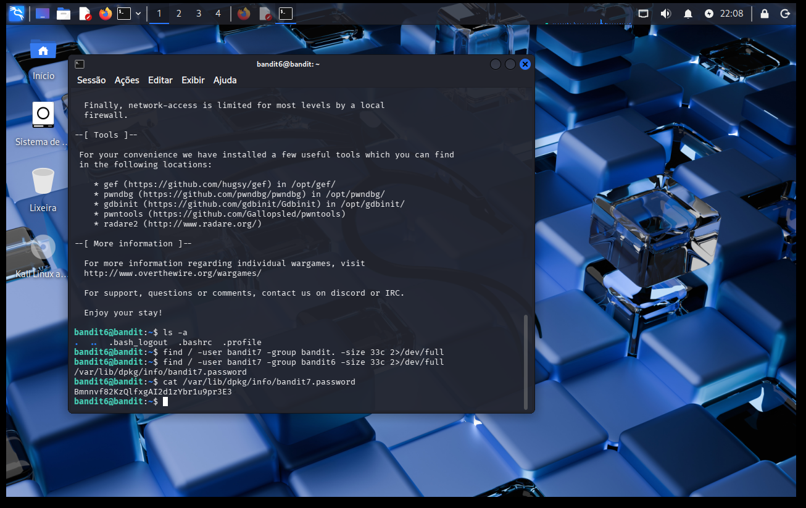 | 

[↑ Voltar ao topo](#topo)